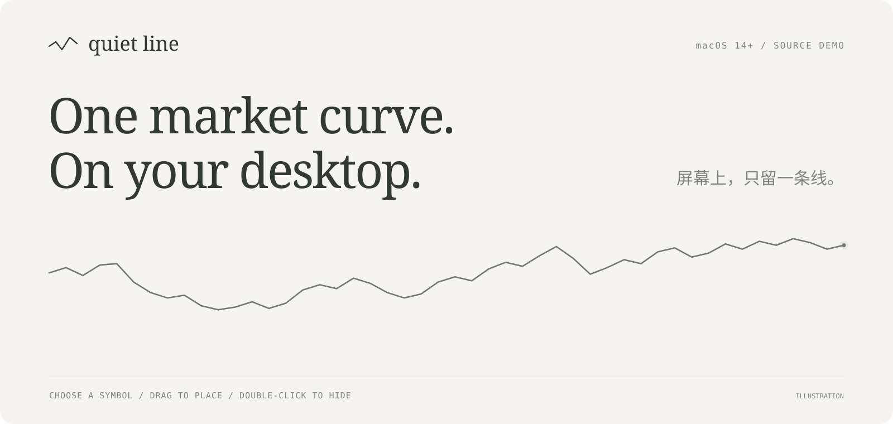
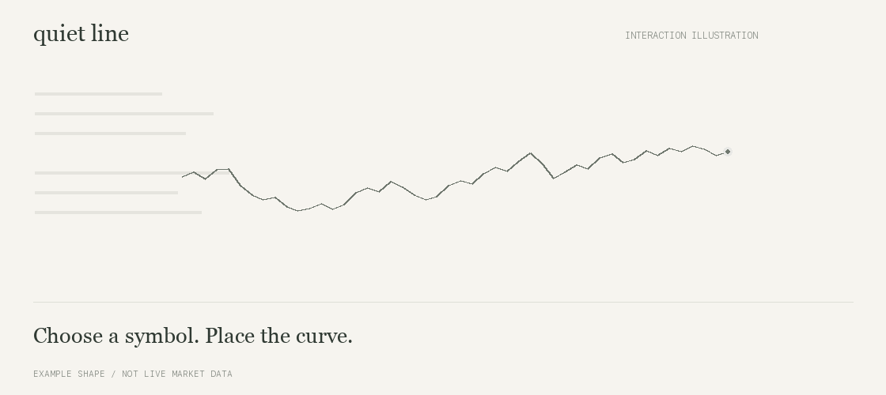

<p align="center">
  
</p>

# Quiet Line

**One market curve on your desktop.**

Choose a symbol, place its transparent curve in a corner, and double-click to hide it. Keep the line and endpoint, or let a sentence or novel scroll along the real price shape. Symbol names and settings live in a separate window.

[Download for Mac](https://github.com/rzr002/quiet-line/releases/latest) · [简体中文](README.md) · [Development](docs/DEVELOPMENT.md) · [Report an issue](https://github.com/rzr002/quiet-line/issues)

**Early demo for macOS 14+. Universal download for Apple Silicon and Intel. The settings interface is currently in Chinese.**

## Keep one shape in view



*Interaction illustration using an example curve. This is not a desktop capture or a live quote.*

| Action | Interaction |
| --- | --- |
| Choose a symbol | Click it in settings |
| Place the curve | Drag its transparent window |
| Hide it | Double-click the curve area |
| Bring it back | Open settings and click 显示曲线 (Show curve) |
| Form the curve with text | Select 文字曲线 (Text curve), type text or import a TXT file |
| Adjust its appearance | Change color, opacity, stroke width and dimensions |
| Open settings or quit | Use the curve icon in the macOS menu bar |

The borderless window stays above other windows while settings can be closed separately. Its small endpoint breathes while the data is fresh and the connection is healthy. New prices move the endpoint with a short transition.

## Read along the curve

Text mode shows upright characters following the actual market shape, scrolling from right to left in a loop. It draws text without the line or endpoint. Paste a sentence, use a sample, or import a local TXT file (up to 5 MB; UTF-8, BOM-marked UTF-16, or GB18030).

Set speed from 0 to 100 px/s and font size from 9 to 24 pt. Zero pauses scrolling. Market updates and symbol changes keep the reading position; changing the text or font size restarts it. Text and preferences stay on the local Mac. Weather copy is an example, not a live forecast. Scrolling alone does not indicate a new trade.

## Run on your Mac

### Install the DMG

**[Download Quiet Line 0.4.0 for Mac](https://github.com/rzr002/quiet-line/releases/download/v0.4.0/Quiet-Line-0.4.0-macOS-universal.dmg)** · [ZIP alternative](https://github.com/rzr002/quiet-line/releases/download/v0.4.0/Quiet-Line-0.4.0-macOS-universal.zip)

1. Open the DMG and drag `Quiet Line.app` onto **Applications**.
2. Open Quiet Line from Applications. Quit an existing copy before replacing it.
3. Choose a symbol, drag the curve into place, then click 收起设置 (Close settings).

The download is precompiled and does not require Swift, Xcode or Python to run. Requires macOS 14+. The Universal binary contains both Apple Silicon and Intel slices.

This demo is ad-hoc signed and **has not been signed with a Developer ID or notarized by Apple**. A first-launch security prompt is possible. Check the release source and checksum file, then follow [Apple's guidance](https://support.apple.com/en-us/102445) if you choose to trust this version. See [INSTALL.txt](docs/INSTALL.txt) for details.

### Build from source

Building locally requires a Swift 6 toolchain:

```bash
git clone https://github.com/rzr002/quiet-line.git
cd quiet-line
bash scripts/build.sh
open "dist/Quiet Line.app"
```

You can also double-click `启动.command` in an existing source folder. Rebuild after updating the source.

## Markets

| Type | Built-in examples | Actual price source |
| --- | --- | --- |
| US ETF exposure | QQQUSDT, SPYUSDT | Binance USDⓈ-M perpetual contracts |
| US equity exposure | NVDAUSDT, AAPLUSDT, TSLAUSDT, MSFTUSDT, GOOGLUSDT, AMZNUSDT, METAUSDT | Binance USDⓈ-M perpetual contracts |
| Crypto | BTC, ETH, SOL, BNB, XRP, DOGE, ADA and AVAX USDT pairs | Binance spot |

QQQUSDT is selected by default. Choose 永续 (perpetual) or 现货 (spot) in settings to add another symbol.

**QQQUSDT is a perpetual contract. Its price can differ from QQQ ETF shares and the Nasdaq index.** Contract availability depends on the upstream market and the current network.

## How the curve updates

Choose a 1-hour, 4-hour or 24-hour window. Quiet Line loads historical candles and then targets a two-second interval for the latest aggregate trade. It updates the last point within the current bucket and advances the window when a new bucket begins.

Hiding the curve pauses scheduled requests. A stale connection stops the breathing endpoint; a failed request hides the curve and displays an error in settings. Network delay, upstream processing and quiet trading periods affect what changes on screen.

The y-range is normalized to the visible series. Curve height is not an absolute return comparison between symbols.

## Scope

This is a macOS-only, single-curve demo. It reads public market data without account credentials and does not execute trades. Preferences stay on the local Mac.

For connectivity, tests and build details, see [Development](docs/DEVELOPMENT.md). Report issues with your macOS version, symbol, spot/perpetual selection and the error shown in settings.
