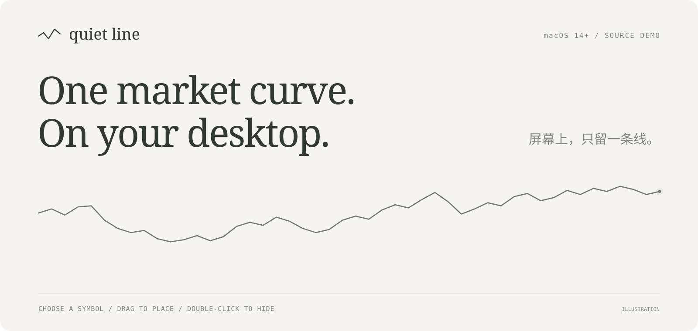
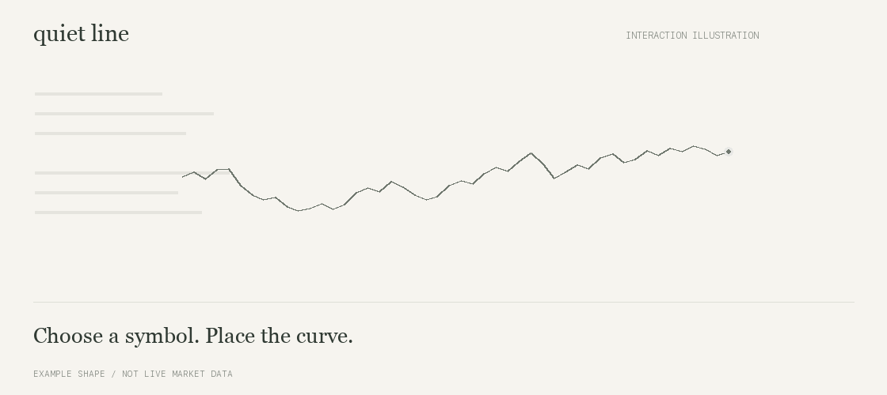

<p align="center">
  
</p>

<p align="center">
  <a href="#在-mac-上启动">在 Mac 上启动</a> ·
  <a href="README.en.md">English</a> ·
  <a href="docs/DEVELOPMENT.md">开发说明</a> ·
  <a href="https://github.com/rzr002/quiet-line/issues">反馈问题</a>
</p>

# Quiet Line

**屏幕上，只留一条线。**

选一个标的，把透明曲线放到桌面一角。你看得到走势，悬浮窗口只显示曲线和右端的小圆点。需要收起时，双击曲线区域。

适合已经知道自己在看什么、只想偶尔扫一眼走势的 Mac 用户。

**当前为 macOS 14+ 源码 demo，首次构建需要 Swift 6 工具链。设置界面为中文。**

## 选好、摆好，继续手头的事

<p align="center">
  
</p>

*展示图是交互示意，使用示例走势；不是桌面截图或实时行情。*

| 你要做的事 | 操作 |
| --- | --- |
| 选择行情 | 在设置页点击标的 |
| 摆放曲线 | 单击拖动曲线所在区域 |
| 临时隐藏 | 双击曲线区域 |
| 再次显示 | 打开设置，点「显示曲线」 |
| 调整外观 | 设置颜色、不透明度、线宽和窗口宽高 |
| 打开设置或退出 | 点击 macOS 菜单栏的曲线图标 |

曲线保持置顶，设置窗口可以单独收起。浮窗的标题、数字和坐标都留空，悬停也只显示曲线。右端的小点在行情新鲜、连接正常时轻微呼吸，新成交到来时平滑移动。

## 在 Mac 上启动

### 已有这个项目文件夹

双击 **`启动.command`**。首次运行会构建应用，随后打开设置窗口。

构建完成后，也可以直接双击 **`dist/Quiet Line.app`**。

### 从 GitHub 获取源码

先准备 macOS 14 或更新版本，以及 Swift 6 工具链，再在终端执行：

```bash
git clone https://github.com/rzr002/quiet-line.git
cd quiet-line
bash scripts/build.sh
open "dist/Quiet Line.app"
```

在左侧选择标的，拖动曲线到合适位置，然后点「收起设置」。后续启动直接打开生成的 `.app`。

当前没有独立安装器。构建脚本生成当前 Mac 架构的应用，并进行本地临时签名；它没有经过 Apple 公证。

## 纳指、美股映射与加密货币

| 行情类型 | 内置示例 | 实际价格来源 |
| --- | --- | --- |
| 纳指 / 标普 ETF 映射 | QQQUSDT、SPYUSDT | Binance USDⓈ-M 永续合约 |
| 美股映射 | NVDAUSDT、AAPLUSDT、TSLAUSDT、MSFTUSDT、GOOGLUSDT、AMZNUSDT、METAUSDT | Binance USDⓈ-M 永续合约 |
| 加密货币 | BTC、ETH、SOL、BNB、XRP、DOGE、ADA、AVAX 的 USDT 交易对 | Binance 现货 |

默认打开 QQQUSDT。还可以在设置页选择「永续 / 现货」，手动添加代码。

**这里的 QQQUSDT 是币安永续合约，其价格可能与 QQQ ETF 现货和纳斯达克指数不同。** 标的可用性以源站和当前网络返回为准。

## 更新方式

- 曲线范围可以选最近 1 小时、4 小时或 24 小时。
- 首次读取历史 K 线，之后以每 2 秒为目标间隔请求最新聚合成交。
- 新价格更新当前时间段的末端，进入下一个时间段后向前滚动。
- 隐藏曲线后暂停定时请求；数据过期时小点停止呼吸，请求失败时隐藏曲线，并在设置页提示。

实际更新速度包含网络和接口处理时间；全天交易也可能暂时没有新的成交。曲线按可见价格范围归一化，高度不能用来比较不同标的的绝对涨跌幅。

## 常见问题

**Windows 能用吗？** 目前只实现了 macOS 版本。

**曲线隐藏后怎么找回来？** 点菜单栏曲线图标，打开设置，再点「显示曲线」。关闭设置窗口会继续保留菜单栏入口。

**为什么没有行情？** 先查看设置页的错误提示。公开接口可能延迟、限流或因网络及地区不可用；合约连接说明见[网络配置](docs/DEVELOPMENT.md#网络配置)。

**需要登录或 API Key 吗？** 使用公开行情即可。应用只展示行情，不接入交易账户。

**我想看多个曲线？** 当前 demo 一次显示一个标的。

## 开发与反馈

使用原生 SwiftUI 和 AppKit；应用没有第三方运行时依赖。[开发说明](docs/DEVELOPMENT.md)包含构建、测试和数据口径。

反馈问题时，请附上 macOS 版本、标的代码、现货或永续类型，以及设置页的错误信息。
